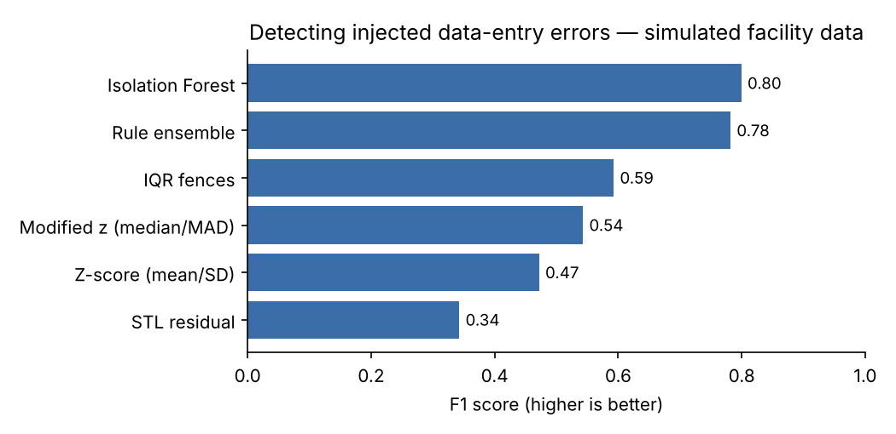
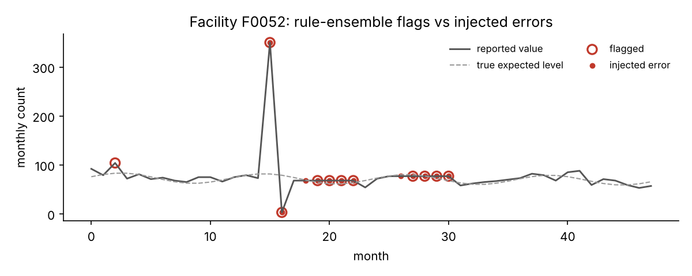

# routine-data-anomaly-detection

**How well do statistical and machine-learning methods catch data-entry errors in routine health data — and can they explain why?**

Routine health information systems (DHIS2, eCHIS, national data warehouses) contain errors that distort indicators: double entries, extra digits, partial reports and values copied forward month after month. This repository benchmarks six detectors on simulated monthly facility data where every error is known, and produces a **plain-language reason for each flag**.

It is a small, reproducible pilot for my proposed doctoral research, *Trustworthy AI for Imperfect Health Data*.

> **All data are simulated.** No Ministry of Health or patient data are used.

## Results

120 facilities × 48 months (5,760 values), 5.6% labelled anomalies.

| Method | Precision | Recall | F1 | Spike | Extra digit | Drop | Flatline |
|:--|--:|--:|--:|--:|--:|--:|--:|
| Z-score (mean/SD) | 0.98 | 0.31 | 0.47 | 0.60 | 0.98 | 0.14 | 0.02 |
| Modified z (median/MAD) | 0.96 | 0.38 | 0.54 | 0.96 | 1.00 | 0.16 | 0.02 |
| IQR fences | 0.86 | 0.45 | 0.59 | 0.96 | 1.00 | 0.57 | 0.02 |
| STL residual | 0.28 | 0.45 | 0.34 | 0.71 | 0.71 | 0.78 | 0.13 |
| **Isolation Forest** | 0.85 | 0.75 | **0.80** | 0.95 | 1.00 | 0.91 | 0.53 |
| **Rule ensemble** | 0.71 | **0.88** | 0.78 | 0.98 | 1.00 | 0.98 | 0.75 |

(Per-type columns are recall for that error type.)



**What this shows**

1. **Single-value outlier rules (z-score, MAD, IQR) are precise but miss most errors.** They catch large spikes and extra-digit errors, but not partial reports (drops) or copied-forward values (flatlines), which look "normal" in isolation.
2. **Context matters more than the algorithm.** Adding three history-based features — deviation from the facility's usual level, ratio to the same month last year, and runs of repeated values — lifts recall from 0.38 to 0.75–0.88.
3. **A transparent rule ensemble nearly matches Isolation Forest** (F1 0.78 vs 0.80) while every flag comes with a readable reason. For data managers who must verify flags, that trade-off may be worth it.
4. **STL decomposition struggles on short series.** With 48 months and several errors per facility, the seasonal fit absorbs errors and over-flags normal months, even after tuning.

### Explaining flags

Each flag can be explained from the interpretable features (`rdad.explain_flag`):

| Facility | Month | Value | Injected error | Reason given |
|---|---|---|---|---|
| F0000 | 16 | 410 | extra digit | +17.2 MADs from this facility's usual level; 8.2× above the same month last year |
| F0000 | 43 | 3 | drop | 13.8× below the same month last year |
| F0001 | 16 | 49 | flatline | same value repeated 4 months in a row |



## Quick start

```bash
pip install -r requirements.txt
python run_benchmark.py   # writes results/
pytest -q                 # 4 tests
```

## Method

- **Simulation** (`rdad/simulate.py`): each facility has its own level, trend and seasonality with Poisson noise. Errors are injected after a 12-month history: spikes (×3–6), extra digits (×10), drops (to 0–20%) and flatlines (value copied for 3–5 months).
- **Features** (`rdad/features.py`): robust z-score, log ratio to the same month last year, log month-on-month change, length of repeated-value run — all computed from the facility's own series.
- **Detectors** (`rdad/detectors.py`): classical z-score, modified z-score, IQR fences, robust STL residuals, Isolation Forest on the features, and a transparent rule ensemble.
- **Evaluation** (`rdad/evaluate.py`): precision, recall and F1 against the injected labels, overall and by error type.

## Limitations and next steps

- Simulated errors are cleaner than real ones; the next step is evaluation on real routine data with verified error labels (under data-sharing approval).
- Detectors work one indicator at a time. Real errors often show up as **inconsistency between related indicators** (e.g. tests vs positives) and between data sources — a multivariate extension is planned.
- Flags carry no measure of confidence. Adding **calibrated uncertainty** (e.g. conformal prediction) so that verification effort can be prioritised is a core aim of the doctoral project.
- The first month of a flatline is not caught by the rules (it looks like a normal value until it repeats).

## Related

- [health-data-quality-checks](https://github.com/moseskizito/health-data-quality-checks) — completeness, timeliness, consistency and outlier checks in Python and PostgreSQL
- Kizito, M., Nabasirye, A. & Kaggwa, L. (2026). *Strengthening Data Quality in National Health Data Warehouses.* ACM SEiGS '26. [doi:10.1145/3786176.3788341](https://doi.org/10.1145/3786176.3788341)

## License

MIT © Moses Kizito
